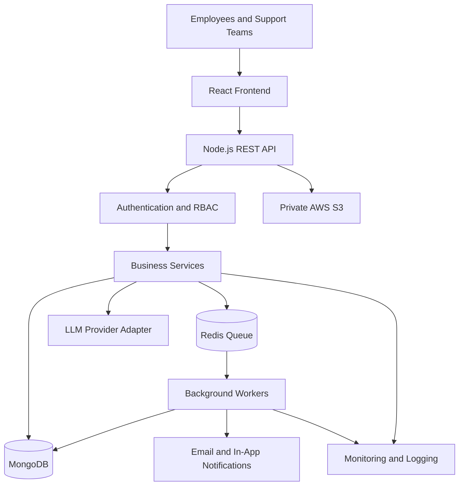

# Smart Office Operations Request & SLA Management System

## 1. Executive Summary

### 1.1 Problem Statement

Office requests are frequently submitted through emails, telephone calls, messaging applications, and informal conversations. This makes it difficult to track ownership, prioritize work, manage approvals, monitor SLA deadlines, and provide operational reports.

### 1.2 Proposed Solution

Develop a centralized Smart Office Operations Request & SLA Management System that enables employees to raise, track, and resolve office operational requests through a single portal.

AI assists with request classification, priority recommendations, assignment suggestions, and knowledge article retrieval. Humans review AI recommendations, and authorized humans must approve actions requiring approval under organizational policy.

### 1.3 Finalized Decisions

| Decision | Selection |
|---|---|
| Request scope | All supported office operations |
| AI handling | Assisted; recommendations require human review |
| Approval policy | Human approval for policy-controlled actions |
| Frontend | React.js + TypeScript |
| Backend | Node.js + TypeScript |
| Database | MongoDB |
| Background processing | Redis + BullMQ |
| Deployment | AWS |
| API style | REST |
| Authentication | Enterprise OIDC where available |
| File storage | Private AWS S3 bucket |
| Monitoring | Centralized logs, metrics, traces, and alerts |

### 1.4 Supported Request Categories

- IT support: hardware, software, network, access requests.
- Facilities: lighting, air conditioning, furniture, maintenance.
- Administration: office supplies, meeting rooms, visitor coordination.
- Non-confidential HR: general policy information and onboarding guidance.
- Other office operations: configurable categories approved by administrators.

Confidential HR, medical, payroll, disciplinary, and similarly restricted records must use separately authorized workflows or remain outside the ordinary request workflow.

---

## 2. Objectives and Scope

### 2.1 Objectives

1. Centralize office requests.
2. Provide request ownership and status visibility.
3. Improve assignment and prioritization.
4. Track response and resolution SLAs.
5. Automatically notify teams about approaching deadlines.
6. Provide AI-assisted classification and knowledge retrieval.
7. Require human approval for controlled actions.
8. Maintain complete business auditability.
9. Provide dashboards and reports.
10. Support reliable operation when external AI providers fail.

### 2.2 Functional Requirements

| ID | Requirement |
|---|---|
| FR-01 | Authentication and role-based authorization |
| FR-02 | Request creation, retrieval, updating, and cancellation |
| FR-03 | AI-assisted request classification |
| FR-04 | Human review and override of AI suggestions |
| FR-05 | Assignment and reassignment |
| FR-06 | Comments, attachments, and request history |
| FR-07 | Validated workflow transitions |
| FR-08 | SLA calculation and monitoring |
| FR-09 | Human approval workflow |
| FR-10 | Notifications and escalations |
| FR-11 | Knowledge article management |
| FR-12 | Dashboards and reports |
| FR-13 | Audit logging |
| FR-14 | Administration and configuration |
| FR-15 | Background processing and retries |
| FR-16 | Monitoring and health checks |

### 2.3 Non-Functional Requirements

- Secure authentication and authorization.
- Reliable and idempotent background jobs.
- Configurable business rules and SLA policies.
- Structured logs and operational metrics.
- Accessible and responsive user interface.
- Automated unit, integration, security, and end-to-end tests.
- Backup and disaster recovery procedures.
- Documented API contracts and deployment configuration.

---

## 3. User Roles

| Role | Responsibilities |
|---|---|
| Employee | Create and track requests, comment, upload permitted files |
| Support Agent | Investigate, update, and resolve assigned requests |
| Team Lead | Manage queues, assignments, and escalations |
| Approver | Approve or reject controlled actions |
| Administrator | Manage categories, teams, SLA policies, and configuration |
| Auditor | Read authorized audit records and reports |
| System Worker | Execute scheduled jobs and asynchronous tasks |

### Authorization Rules

- Apply authorization on every protected backend endpoint.
- Restrict access by user, team, department, and request scope.
- Employees cannot approve their own controlled actions where prohibited.
- AI cannot approve actions or grant permissions.
- Audit administrative and security-sensitive changes.
- Never rely exclusively on frontend visibility to enforce permissions.

---

## 4. High-Level Architecture



### 4.1 Component Responsibilities

| Component | Responsibility |
|---|---|
| React frontend | Forms, dashboards, request details, approvals |
| REST API | Input validation, authorization, routing, response handling |
| Authentication module | Identity verification and session management |
| Request module | Request lifecycle and business rules |
| AI assistance module | Classification suggestions and knowledge retrieval |
| Assignment module | Queue management and routing |
| Approval module | Approval requests and decisions |
| SLA module | Deadline calculation and breach detection |
| Notification module | Email and in-app notification delivery |
| Worker | SLA processing, escalations, retries, exports |
| MongoDB | Operational records and metadata |
| S3 | Private attachment storage |
| Observability | Logs, metrics, traces, and alerts |

### 4.2 Technology Stack

- Frontend: React.js, TypeScript.
- Backend: Node.js, TypeScript, Express.
- Validation: Zod.
- Database: MongoDB.
- Background jobs: Redis and BullMQ.
- Authentication: OIDC-compatible enterprise identity provider.
- AI: Provider-independent LLM adapter.
- File storage: AWS S3.
- Deployment: Docker on AWS ECS/Fargate or an equivalent approved platform.
- Secrets: AWS Secrets Manager.
- Monitoring: Amazon CloudWatch and compatible tracing tools.
- Testing: Vitest/Jest, Supertest, Playwright.
- API documentation: OpenAPI 3.x.

Use supported, pinned dependencies and commit the lockfile.

---

## 5. Project Structure

```text
smart-office-ops/
├── apps/
│   ├── web/
│   │   └── src/
│   │       ├── app/
│   │       ├── components/
│   │       ├── features/
│   │       │   ├── auth/
│   │       │   ├── requests/
│   │       │   ├── assignments/
│   │       │   ├── ai-assistance/
│   │       │   ├── approvals/
│   │       │   ├── sla/
│   │       │   ├── knowledge/
│   │       │   ├── notifications/
│   │       │   ├── dashboards/
│   │       │   └── administration/
│   │       ├── api/
│   │       └── types/
│   ├── api/
│   │   └── src/
│   │       ├── config/
│   │       ├── middleware/
│   │       ├── modules/
│   │       ├── shared/
│   │       ├── app.ts
│   │       └── server.ts
│   └── worker/
│       └── src/
│           ├── jobs/
│           └── worker.ts
├── packages/
│   ├── contracts/
│   └── config/
├── docs/
│   ├── architecture.md
│   └── openapi.yaml
├── tests/
│   ├── unit/
│   ├── integration/
│   ├── security/
│   └── e2e/
├── .env.example
├── Dockerfile
├── docker-compose.yml
└── README.md
```

Backend modules should include authentication, users, teams, departments, requests, comments, attachments, assignments, AI assistance, approvals, SLA, escalations, notifications, knowledge, dashboards, reports, audit, and administration.

Each module should separate routes/controllers, validation, services, repositories, domain rules, and tests.

---

## 6. MongoDB Data Model

Use MongoDB ObjectIds internally, UTC timestamps, schema validation, and indexes. Store files in S3 rather than embedding them in request documents.

### 6.1 Collections

| Collection | Purpose |
|---|---|
| `users` | User identities, departments, teams, roles |
| `departments` | Organizational departments |
| `teams` | Support teams and membership |
| `requestCategories` | Configurable request categories |
| `requests` | Main request records |
| `requestEvents` | Append-only lifecycle history |
| `comments` | Public comments and internal notes |
| `attachments` | Attachment metadata and S3 object keys |
| `aiSuggestions` | AI suggestions and human review outcomes |
| `slaPolicies` | Versioned SLA rules |
| `businessCalendars` | Working hours, holidays, time zones |
| `escalationRules` | Escalation thresholds and recipients |
| `approvals` | Approval decisions and policy snapshots |
| `notifications` | Notification delivery and retry status |
| `knowledgeArticles` | Published and draft knowledge articles |
| `auditLogs` | Security and business audit events |
| `counters` | Optional atomic public-ID sequence |

### 6.2 Request Schema

```json
{
  "_id": "ObjectId",
  "publicId": "OPS-1042",
  "requesterId": "ObjectId",
  "title": "Office Wi-Fi is unavailable",
  "description": "Unable to connect to the office network.",
  "domain": "IT",
  "categoryId": "ObjectId",
  "priority": "P2",
  "status": "ASSIGNED",
  "teamId": "ObjectId",
  "assigneeId": "ObjectId",
  "source": "WEB",
  "approvalState": "NOT_REQUIRED",
  "sla": {
    "policyId": "ObjectId",
    "policyVersion": 1,
    "responseDueAt": "ISODate",
    "resolutionDueAt": "ISODate",
    "firstRespondedAt": null,
    "pausedAt": null,
    "totalPausedSeconds": 0
  },
  "resolution": null,
  "createdAt": "ISODate",
  "updatedAt": "ISODate",
  "version": 1
}
```

### 6.3 AI Suggestion Schema

```json
{
  "_id": "ObjectId",
  "requestId": "ObjectId",
  "provider": "configured-provider",
  "model": "configured-model",
  "promptVersion": "triage-v1",
  "suggestions": {
    "categoryCode": "IT_NETWORK",
    "priority": "P2",
    "teamCode": "NETOPS",
    "knowledgeArticleIds": []
  },
  "confidence": {
    "category": 0.91,
    "priority": 0.76,
    "team": 0.88
  },
  "status": "PENDING_REVIEW",
  "reviewedBy": null,
  "reviewedAt": null,
  "overrides": [],
  "createdAt": "ISODate"
}
```

Confidence scores are model estimates unless independently calibrated. Store concise rationales, not hidden chain-of-thought.

### 6.4 Indexes

```javascript
db.requests.createIndex(
  { publicId: 1 },
  { unique: true }
);

db.requests.createIndex({
  requesterId: 1,
  createdAt: -1
});

db.requests.createIndex({
  teamId: 1,
  status: 1,
  "sla.resolutionDueAt": 1
});

db.requests.createIndex({
  assigneeId: 1,
  status: 1,
  updatedAt: -1
});

db.requestEvents.createIndex({
  requestId: 1,
  createdAt: 1
});

db.aiSuggestions.createIndex({
  requestId: 1,
  createdAt: -1
});

db.notifications.createIndex(
  { dedupeKey: 1 },
  { unique: true }
);

db.auditLogs.createIndex({
  resourceId: 1,
  createdAt: -1
});
```

Create additional indexes for approval queues, categories, team membership, knowledge search, and notification processing.

### 6.5 Data Integrity

- Use optimistic concurrency or version checks for critical updates.
- Use MongoDB transactions where appropriate and supported.
- Keep request events and audit records protected from ordinary user modification.
- Snapshot SLA policy versions when applying them to requests.
- Never treat public request IDs as authorization credentials.
- Filter records by authorization scope before returning search results.

---

## 7. API Standards

All endpoints use the `/api/v1` prefix.

### 7.1 Response Format

Success:

```json
{
  "success": true,
  "data": {},
  "meta": {
    "correlationId": "uuid"
  }
}
```

Error:

```json
{
  "success": false,
  "error": {
    "code": "VALIDATION_ERROR",
    "message": "Invalid request.",
    "details": []
  },
  "meta": {
    "correlationId": "uuid"
  }
}
```

### 7.2 Standards

- Use JSON request and response bodies.
- Use UTC ISO 8601 timestamps.
- Validate path parameters, query parameters, and request bodies.
- Apply authorization to every protected operation.
- Paginate list endpoints.
- Allowlist sort fields.
- Use idempotency keys for retryable creation operations.
- Use version checks for concurrent updates.
- Generate correlation IDs.
- Never return stack traces, credentials, or restricted internal notes.

### 7.3 HTTP Status Codes

| Status | Meaning |
|---|---|
| 200 | Successful read or update |
| 201 | Resource created |
| 202 | Background processing accepted |
| 204 | Successful operation without body |
| 400 | Invalid request or workflow transition |
| 401 | Unauthenticated |
| 403 | Unauthorized action |
| 404 | Resource unavailable or not visible |
| 409 | Conflict or stale version |
| 413 | File too large |
| 415 | Unsupported media type |
| 422 | Business validation failure |
| 429 | Rate limit exceeded |
| 500 | Unexpected server error |
| 503 | Dependency unavailable |

---

## 8. Complete REST API Endpoint Catalogue

### 8.1 Authentication and Users

| Method | Endpoint | Purpose |
|---|---|---|
| GET | `/auth/me` | Get current authenticated identity |
| POST | `/auth/logout` | End application session where supported |
| POST | `/auth/refresh` | Refresh session when applicable |
| GET | `/users/me` | Get current profile |
| PATCH | `/users/me` | Update permitted profile preferences |
| GET | `/users` | Search users for assignment |
| GET | `/users/:userId` | Get permitted user details |
| GET | `/departments` | List departments |
| GET | `/teams` | List accessible teams |
| GET | `/teams/:teamId` | Get team details |
| GET | `/teams/:teamId/members` | List team members |

Use an enterprise OIDC provider where available. Do not implement a custom password store unless specifically required and security-reviewed.

### 8.2 Request Management

| Method | Endpoint | Purpose |
|---|---|---|
| POST | `/requests` | Create a request |
| GET | `/requests` | List/search authorized requests |
| GET | `/requests/:requestId` | Get request details |
| PATCH | `/requests/:requestId` | Update permitted editable fields |
| POST | `/requests/:requestId/submit` | Submit a draft |
| POST | `/requests/:requestId/cancel` | Cancel a request |
| POST | `/requests/:requestId/resolve` | Resolve a request |
| POST | `/requests/:requestId/close` | Close a resolved request |
| POST | `/requests/:requestId/reopen` | Reopen an eligible request |
| GET | `/requests/:requestId/events` | Retrieve lifecycle history |
| GET | `/requests/:requestId/timeline` | Retrieve permitted activity timeline |
| GET | `/requests/:requestId/related` | Find authorized related requests |

Supported query parameters include `page`, `limit`, `status`, `priority`, `domain`, `categoryId`, `teamId`, `assigneeId`, `requesterId`, `createdFrom`, `createdTo`, and `overdue`.

### 8.3 Comments and Attachments

| Method | Endpoint | Purpose |
|---|---|---|
| GET | `/requests/:requestId/comments` | List visible comments |
| POST | `/requests/:requestId/comments` | Add a comment |
| PATCH | `/comments/:commentId` | Edit a comment where permitted |
| DELETE | `/comments/:commentId` | Delete or redact where policy permits |
| POST | `/requests/:requestId/attachments` | Upload an attachment |
| GET | `/attachments/:attachmentId` | Get attachment metadata |
| GET | `/attachments/:attachmentId/download` | Obtain authorized temporary download access |
| DELETE | `/attachments/:attachmentId` | Remove an attachment where permitted |

Validate file size and content type, scan for malware, use private S3 storage, and expire download links. Never expose S3 credentials or internal object keys.

### 8.4 AI Assistance and Human Review

| Method | Endpoint | Purpose |
|---|---|---|
| POST | `/requests/:requestId/ai-suggestions` | Generate triage suggestions |
| GET | `/requests/:requestId/ai-suggestions` | List suggestion history |
| GET | `/ai-suggestions/:suggestionId` | Get suggestion details |
| POST | `/ai-suggestions/:suggestionId/review` | Accept or override suggestions |
| POST | `/requests/:requestId/knowledge-suggestions` | Retrieve relevant articles |
| POST | `/ai-suggestions/:suggestionId/feedback` | Record reviewer feedback |

Example request:

```json
{
  "includeKnowledgeArticles": true
}
```

Example human review:

```json
{
  "decision": "OVERRIDE",
  "acceptedFields": {
    "categoryCode": "IT_NETWORK",
    "teamCode": "NETOPS"
  },
  "overrides": {
    "priority": {
      "suggested": "P2",
      "selected": "P1",
      "reason": "Multiple employees are affected."
    }
  }
}
```

Requirements:

- Validate model output against a strict schema.
- Validate category, priority, and team against current policy.
- Store suggestions separately from accepted values.
- Record reviewer, timestamp, decision, and overrides.
- Never apply AI suggestions silently.
- Continue manual processing when the AI provider fails.
- Never let the model execute arbitrary database queries or actions.

### 8.5 Assignment and Queue Management

| Method | Endpoint | Purpose |
|---|---|---|
| GET | `/queues/my` | List current user's assigned work |
| GET | `/queues/teams/:teamId` | List team queue |
| POST | `/requests/:requestId/assign` | Assign a request |
| POST | `/requests/:requestId/reassign` | Change ownership |
| POST | `/requests/:requestId/claim` | Claim an eligible request |
| POST | `/requests/:requestId/transfer` | Transfer request to another team |
| GET | `/assignments/rules` | List routing rules |
| POST | `/assignments/rules` | Create routing rule |
| PATCH | `/assignments/rules/:ruleId` | Update routing rule |
| DELETE | `/assignments/rules/:ruleId` | Deactivate routing rule |

Use deterministic routing rules based on category, location, team coverage, and workload. AI recommendations are advisory only.

### 8.6 Workflow Management

| Method | Endpoint | Purpose |
|---|---|---|
| GET | `/workflow/transitions` | List allowed transitions |
| POST | `/requests/:requestId/transitions` | Execute a validated transition |
| GET | `/workflow/policies` | List workflow policies |
| POST | `/workflow/policies` | Create a workflow policy |
| PATCH | `/workflow/policies/:policyId` | Update workflow policy |

Never allow users to bypass workflow rules by directly setting arbitrary status fields.

### 8.7 Human Approval

| Method | Endpoint | Purpose |
|---|---|---|
| GET | `/approvals` | List approval tasks |
| GET | `/approvals/:approvalId` | Get approval details |
| POST | `/approvals` | Create an approval request |
| POST | `/approvals/:approvalId/approve` | Approve a controlled action |
| POST | `/approvals/:approvalId/reject` | Reject a controlled action |
| POST | `/approvals/:approvalId/cancel` | Cancel an eligible pending approval |
| GET | `/requests/:requestId/approvals` | Retrieve approval history |

Approval requirements:

1. Verify the approval is pending.
2. Verify the approver's authorization and scope.
3. Prevent prohibited self-approval.
4. Reject duplicate or stale decisions.
5. Persist the decision and audit event reliably.
6. Execute the controlled action only after approval.
7. Revalidate permissions immediately before execution.
8. Record failures during action execution.

Approval must be enforced by backend business logic, not only by the UI.

### 8.8 SLA and Escalation Management

| Method | Endpoint | Purpose |
|---|---|---|
| GET | `/requests/:requestId/sla` | Get request SLA status |
| GET | `/sla/policies` | List SLA policies |
| POST | `/sla/policies` | Create SLA policy |
| GET | `/sla/policies/:policyId` | Get SLA policy |
| PATCH | `/sla/policies/:policyId` | Update policy for future application |
| POST | `/sla/policies/:policyId/deactivate` | Deactivate policy |
| GET | `/sla/calendars` | List business calendars |
| POST | `/sla/calendars` | Create business calendar |
| PATCH | `/sla/calendars/:calendarId` | Update calendar |
| GET | `/escalations/rules` | List escalation rules |
| POST | `/escalations/rules` | Create escalation rule |
| PATCH | `/escalations/rules/:ruleId` | Update escalation rule |
| GET | `/escalations` | List authorized escalations |
| POST | `/escalations/:escalationId/acknowledge` | Acknowledge escalation |
| POST | `/escalations/:escalationId/resolve` | Resolve escalation record |

SLA calculations must support business hours, weekends, holidays, time zones, pause conditions, warning thresholds, and escalation policies.

A background worker must detect approaching deadlines and breaches. Escalation processing must be idempotent.

### 8.9 Notifications

| Method | Endpoint | Purpose |
|---|---|---|
| GET | `/notifications` | List current user's notifications |
| GET | `/notifications/unread-count` | Get unread count |
| POST | `/notifications/:notificationId/read` | Mark one notification read |
| POST | `/notifications/read-all` | Mark permitted notifications read |
| GET | `/notification-preferences` | Get notification preferences |
| PATCH | `/notification-preferences` | Update preferences |
| GET | `/admin/notification-templates` | List templates |
| POST | `/admin/notification-templates` | Create template |
| PATCH | `/admin/notification-templates/:templateId` | Update template |

Use retries with backoff, deduplication keys, and delivery tracking. Never expose internal comments or sensitive details to unauthorized recipients.

### 8.10 Knowledge Management

| Method | Endpoint | Purpose |
|---|---|---|
| GET | `/knowledge/articles` | Search published articles |
| GET | `/knowledge/articles/:articleId` | Read an article |
| POST | `/knowledge/articles` | Create a draft |
| PATCH | `/knowledge/articles/:articleId` | Update an article |
| POST | `/knowledge/articles/:articleId/publish` | Publish an approved article |
| POST | `/knowledge/articles/:articleId/archive` | Archive an article |
| POST | `/knowledge/articles/:articleId/feedback` | Record helpfulness feedback |
| GET | `/knowledge/categories` | List knowledge categories |

AI retrieval must only include articles that the current user is authorized to access.

### 8.11 Dashboards and Reporting

| Method | Endpoint | Purpose |
|---|---|---|
| GET | `/dashboard/me` | Personal dashboard |
| GET | `/dashboard/team/:teamId` | Team dashboard |
| GET | `/dashboard/operations` | Organization-level operational dashboard |
| GET | `/reports/requests` | Request volume and status report |
| GET | `/reports/sla` | SLA compliance report |
| GET | `/reports/workload` | Workload report |
| GET | `/reports/ai-quality` | AI acceptance and override metrics |
| POST | `/reports/exports` | Start a report export |
| GET | `/reports/exports/:exportId` | Check export status |
| GET | `/reports/exports/:exportId/download` | Download authorized export |

All reports and exports must enforce the same data-access rules as interactive requests.

### 8.12 Administration and Monitoring

| Method | Endpoint | Purpose |
|---|---|---|
| GET | `/admin/config` | Read system configuration |
| PATCH | `/admin/config` | Update system configuration |
| GET | `/admin/categories` | List request categories |
| POST | `/admin/categories` | Create category |
| PATCH | `/admin/categories/:categoryId` | Update category |
| POST | `/admin/categories/:categoryId/deactivate` | Deactivate category |
| GET | `/admin/roles` | List roles and permissions |
| GET | `/admin/audit-logs` | Search authorized audit records |
| GET | `/admin/audit-logs/:auditId` | Get audit record |
| GET | `/health/live` | Liveness check |
| GET | `/health/ready` | Readiness check |
| GET | `/metrics` | Restricted operational metrics |

Do not provide ordinary users with audit-log modification or deletion capabilities.

---

## 9. Request Lifecycle

### 9.1 Statuses

- `DRAFT`
- `SUBMITTED`
- `PENDING_APPROVAL`
- `OPEN`
- `ASSIGNED`
- `IN_PROGRESS`
- `WAITING_FOR_REQUESTER`
- `WAITING_FOR_THIRD_PARTY`
- `RESOLVED`
- `CLOSED`
- `CANCELLED`

Approval status must be stored separately from request status.

### 9.2 Valid Transitions

| Current | Allowed next states |
|---|---|
| DRAFT | SUBMITTED, CANCELLED |
| SUBMITTED | OPEN, ASSIGNED, PENDING_APPROVAL, CANCELLED |
| PENDING_APPROVAL | OPEN, ASSIGNED, CANCELLED |
| OPEN | ASSIGNED, IN_PROGRESS, CANCELLED |
| ASSIGNED | IN_PROGRESS, OPEN, CANCELLED |
| IN_PROGRESS | WAITING_FOR_REQUESTER, WAITING_FOR_THIRD_PARTY, RESOLVED, ASSIGNED |
| WAITING_FOR_REQUESTER | IN_PROGRESS, RESOLVED, CANCELLED |
| WAITING_FOR_THIRD_PARTY | IN_PROGRESS, RESOLVED |
| RESOLVED | CLOSED, IN_PROGRESS |
| CLOSED | Reopen only through an authorized exception workflow |
| CANCELLED | Terminal unless separately restored through an audited administrative process |

Every transition must be validated against the current state, actor, and policy.

### 9.3 Request Creation Flow

1. Authenticate the user.
2. Validate input.
3. Create a request and unique public ID.
4. Evaluate approval requirements.
5. Apply the relevant SLA policy snapshot.
6. Persist lifecycle events.
7. Queue AI suggestions if enabled.
8. Queue routing and notification jobs.
9. Return the request and current status.

Use idempotency keys to prevent duplicate creation on retries.

### 9.4 AI Triage Flow

1. Retrieve authorized request data.
2. Remove unnecessary personal or confidential information.
3. Build a versioned prompt.
4. Request schema-constrained output.
5. Validate all identifiers and values.
6. Persist suggestions and model metadata.
7. Present suggestions to a human reviewer.
8. Apply only explicitly accepted values.
9. Record overrides and feedback.

If AI is unavailable, users must be able to classify and route requests manually.

---

## 10. SLA Engine

### 10.1 SLA Policy

Each policy should contain:

- Response target.
- Resolution target.
- Applicable priority and categories.
- Business calendar and time zone.
- Pause conditions.
- Warning thresholds.
- Escalation actions.
- Version and effective dates.

### 10.2 Illustrative Default Targets

| Priority | First Response | Resolution |
|---|---|---|
| P1 | 15 minutes | 4 business hours |
| P2 | 1 business hour | 8 business hours |
| P3 | 4 business hours | 3 business days |
| P4 | 1 business day | 5 business days |

These values are examples. Administrators must configure approved organizational targets.

### 10.3 SLA Worker

The worker must:

1. Find requests approaching deadlines.
2. Calculate remaining business time.
3. Create warning events.
4. Detect SLA breaches.
5. Apply escalation rules.
6. Notify responsible teams.
7. Persist processing results.
8. Retry transient failures safely.

Do not reset the original SLA simply because a request is reassigned.

---

## 11. Background Jobs

| Job | Purpose |
|---|---|
| `AI_TRIAGE` | Generate AI suggestions |
| `ROUTE_REQUEST` | Apply routing rules |
| `SLA_WARNING` | Notify before deadline |
| `SLA_BREACH` | Record and escalate a breach |
| `SEND_NOTIFICATION` | Deliver email or in-app notifications |
| `SCAN_ATTACHMENT` | Scan uploaded files |
| `GENERATE_REPORT` | Generate authorized exports |
| `CLEANUP_EXPIRED` | Remove expired temporary resources |

Requirements:

- Use BullMQ with a durable Redis deployment.
- Implement idempotency.
- Use exponential backoff and jitter.
- Configure retry limits and dead-letter handling.
- Monitor queue depth and job failures.
- Use a transactional outbox or equivalent pattern where needed to keep database changes and event publication consistent.
- Do not roll back a valid request because an email failed.

---

## 12. Security Architecture

### 12.1 Authentication and Authorization

- Use enterprise OIDC where available.
- Validate token issuer, audience, expiry, and signature.
- Enforce role and organizational scope on every protected endpoint.
- Use deny-by-default authorization.
- Prevent cross-user and cross-team data leakage.
- Rate-limit authentication, search, file uploads, and AI endpoints.

### 12.2 Data Protection

- Use TLS in transit and encryption at rest.
- Store credentials in AWS Secrets Manager or an approved secret store.
- Keep S3 buckets private.
- Use expiring download links.
- Redact secrets from logs.
- Apply data retention policies.
- Restrict external AI processing of confidential information.
- Review provider data retention and residency requirements.

### 12.3 AI Safety

- Treat user requests and retrieved documents as untrusted input.
- Defend against prompt injection.
- Never execute instructions embedded in uploaded content.
- Validate structured outputs.
- Never let AI bypass permissions or approval gates.
- Keep deterministic business policies outside the model.
- Measure classification accuracy, acceptance rates, overrides, and failure rates.
- Provide manual fallback.

### 12.4 Audit Events

Audit at least:

- Authentication and authorization failures.
- Request creation and lifecycle changes.
- Assignment and reassignment.
- AI suggestions and human review.
- Approval decisions.
- SLA policy and routing changes.
- Administrative permission changes.
- Sensitive attachment access where required.
- Report exports.

Audit records must be protected from modification by ordinary application users.

---

## 13. Frontend Screens

Implement:

1. Login.
2. Employee dashboard.
3. Create request.
4. My requests.
5. Request detail and timeline.
6. AI suggestion review.
7. Support queue.
8. Agent workbench.
9. Approval inbox.
10. SLA and escalation dashboard.
11. Knowledge search and editor.
12. Team lead dashboard.
13. Reports and exports.
14. Administration.
15. Audit log viewer.

Each screen must support loading, empty, success, and error states. AI recommendations must be visually distinct from accepted values.

Use a typed API client and accessible UI components.

---

## 14. Testing Strategy

### 14.1 Unit Tests

Test:

- Input validation.
- Request ID generation.
- State transitions.
- Authorization rules.
- Assignment rules.
- SLA business-calendar calculations.
- Pause and resume behavior.
- Approval restrictions.
- AI output validation.
- Notification deduplication.

### 14.2 API Integration Tests

Test:

- Request creation and retrieval.
- Unauthorized access to other users' requests.
- Team queue permissions.
- Comment visibility.
- Attachment access.
- AI suggestion review.
- Assignment and reassignment.
- Approval enforcement.
- SLA policy versioning.
- Notification retries.
- Report export permissions.
- Audit event creation.

### 14.3 End-to-End Scenario

1. Employee submits an IT request.
2. System creates a request ID.
3. AI generates suggestions or falls back to manual triage.
4. Authorized human reviews suggestions.
5. Request is assigned to a support team.
6. Agent investigates and adds an update.
7. SLA worker identifies an approaching deadline.
8. Team lead receives an escalation.
9. Agent resolves the request.
10. Employee views the resolution and closes the request.
11. Audit history contains the required events.

### 14.4 Security Tests

Include broken object-level authorization, privilege escalation, prompt injection, malicious uploads, rate limits, injection attacks, sensitive data leakage, duplicate approvals, and concurrent update conflicts.

---

## 15. Deployment Architecture on AWS

Recommended services:

| Component | AWS Deployment Option |
|---|---|
| Frontend | S3 + CloudFront or approved web hosting |
| API | ECS/Fargate |
| Background worker | Separate ECS/Fargate service |
| Database | MongoDB Atlas on AWS or approved MongoDB deployment |
| Queue | ElastiCache for Redis or compatible managed Redis |
| File storage | Private S3 |
| Secrets | AWS Secrets Manager |
| Monitoring | CloudWatch |
| Identity | Approved OIDC identity provider |
| Email | SES or approved email provider |

Select the exact services based on organizational standards, availability requirements, budget, and data residency.

### 15.1 Environment Variables

Example `.env.example`:

```dotenv
NODE_ENV=development
PORT=3000

MONGODB_URI=
REDIS_URL=

OIDC_ISSUER_URL=
OIDC_CLIENT_ID=
OIDC_CLIENT_SECRET=
OIDC_AUDIENCE=

AI_PROVIDER=
AI_MODEL=
AI_API_KEY=
AI_TIMEOUT_MS=15000

AWS_REGION=
S3_BUCKET=

EMAIL_PROVIDER=
EMAIL_API_KEY=
EMAIL_FROM=

LOG_LEVEL=info
```

Use placeholders only. Production credentials must be injected securely.

### 15.2 CI/CD

1. Install dependencies from the lockfile.
2. Run lint and formatting checks.
3. Run TypeScript checks.
4. Run unit and integration tests.
5. Run dependency and security scans.
6. Build and scan container images.
7. Deploy to a test environment.
8. Run smoke and end-to-end tests.
9. Require production approval where applicable.
10. Monitor deployment health and support rollback.

---

## 16. Monitoring and Observability

Track:

- API request count and latency.
- HTTP error rates.
- Database connection health and latency.
- Queue depth and worker failures.
- AI latency, provider failures, and token usage where available.
- AI suggestion acceptance and override rates.
- SLA warnings and breaches.
- Notification delivery failures.
- Authentication and authorization failures.
- Attachment scan failures.

Use structured JSON logs with correlation IDs. Never log credentials, access tokens, or unnecessary sensitive request content.

Initial performance targets should be validated under realistic load. A suggested target is P95 below 500 ms for ordinary database-backed APIs, excluding external provider calls.

Define recovery-point and recovery-time objectives before production.

---

## 17. Implementation Phases

| Phase | Deliverables |
|---|---|
| 1. Foundation | Repository, identity, users, teams, database, logging |
| 2. Requests | CRUD, comments, attachments, workflow events |
| 3. Operations | Queues, routing, SLA engine, escalations |
| 4. AI | Provider adapter, suggestions, review, knowledge retrieval |
| 5. Approvals | Human approval gates and notifications |
| 6. Reporting | Dashboards, reports, authorized exports |
| 7. Production readiness | Security, performance, recovery, monitoring |

Complete and test each functional slice before moving to the next.

---

## 18. Acceptance Criteria

- [ ] Employees can create and track requests.
- [ ] Agents can manage only authorized queues.
- [ ] Workflow transitions are enforced server-side.
- [ ] AI suggestions remain separate from accepted values.
- [ ] Humans can accept or override AI recommendations.
- [ ] AI failure does not prevent manual processing.
- [ ] Controlled actions require valid human approval.
- [ ] SLA calculations support business calendars and pause rules.
- [ ] Escalations and notifications are idempotent.
- [ ] Attachments are private and scanned.
- [ ] Audit events exist for critical actions.
- [ ] Reports and exports enforce permissions.
- [ ] Tests cover critical workflows and security boundaries.
- [ ] OpenAPI documentation covers implemented endpoints.
- [ ] Backup and recovery procedures are tested.
- [ ] Deployment and configuration instructions are documented.

---

## 19. GitHub Copilot Implementation Instructions

Implement this architecture in the existing repository.

### Mandatory Rules

1. Inspect the repository before modifying files.
2. Preserve existing conventions where practical.
3. Implement actual functionality, not placeholder screens or routes.
4. Implement every applicable endpoint in Section 8.
5. Separate controllers, validation, services, repositories, and domain rules.
6. Enforce authorization on every protected resource.
7. Enforce workflow transitions, SLAs, and approval gates in backend logic.
8. Treat AI outputs as untrusted suggestions.
9. Make background jobs and retryable operations idempotent.
10. Add database indexes and concurrency protection.
11. Implement unit, integration, security, and end-to-end tests.
12. Never hardcode credentials.
13. Maintain OpenAPI documentation.
14. Provide `.env.example`, Docker configuration, and setup instructions.
15. Never claim tests passed unless they were executed successfully.

### Implementation Sequence

1. Repository assessment and foundation.
2. Configuration, contracts, database, logging, and errors.
3. Authentication and access control.
4. Request management, comments, attachments, and lifecycle.
5. Assignment and routing.
6. SLA calculation and escalation workers.
7. AI assistance and human review.
8. Approvals and controlled actions.
9. Notifications and knowledge management.
10. Dashboards, reports, and exports.
11. Security hardening, testing, documentation, and deployment.

### Required Completion Report

After implementation, report:

- Files created or modified.
- Endpoints implemented by functionality.
- Database collections and indexes.
- Frontend screens completed.
- Tests executed and actual results.
- Deployment instructions.
- Known limitations and incomplete requirements.
- Required external configuration.

Do not fabricate successful integrations or test results.

---

## 20. Final Architecture Principles

1. **Human accountability:** AI recommends; authorized humans decide.
2. **Security by design:** Authorization is enforced on the backend.
3. **Reliable operations:** Jobs and notifications are retryable and idempotent.
4. **Auditability:** Critical actions and decisions are recorded.
5. **Modularity:** Business capabilities have clear responsibilities.
6. **Graceful degradation:** Core request processing continues when AI is unavailable.
7. **Incremental delivery:** Implement and test complete functional slices.
8. **Configurable policies:** Categories, SLA targets, and approval rules are not hardcoded.
9. **Operational readiness:** Monitoring, backups, and recovery are part of the solution.
10. **Traceability:** Requests, AI recommendations, human decisions, and outcomes remain linked.
